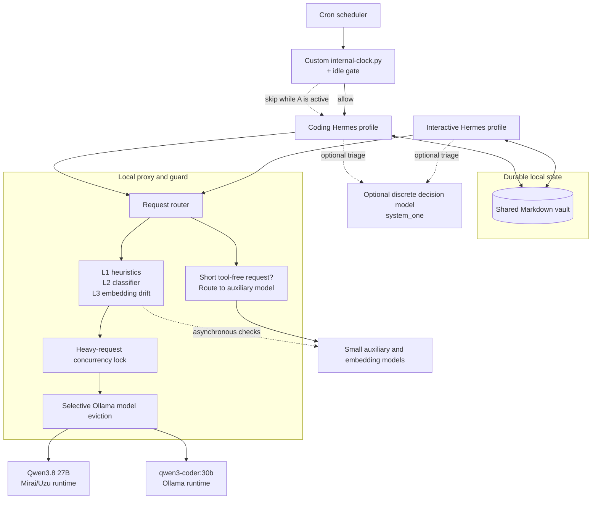

# Dual-LLM Local Architecture

> **Status:** Work in progress / personal architecture notes  
> **Hardware target:** Apple M6 Mac mini with 32 GB unified memory  
> **Agent harness:** [Hermes Agent](https://github.com/NousResearch/hermes-agent)

## Overview

This project documents a local-agent design that uses two specialized language models on one Apple Silicon machine. The models are selected by task and share durable notes, while heavy inference is serialized so both primary models do not generate at the same time.

The two primary roles are:

- **Interactive reasoning:** a dense Qwen3.8 27B variant served through the
  Mirai/Uzu runtime.
- **Coding and UI generation:** `qwen3-coder:30b`, a Mixture-of-Experts model with 30B total parameters and approximately 3.3B active parameters per token. 

The shared state is filesystem-based: both profiles can read and write durable Markdown notes in the same local vault. This is shared durable state, not a single live context window or shared KV cache.

## Public-safe scope

This document intentionally omits credentials, machine identifiers, personal
filesystem paths, the vault name, full prompt files, exact guard patterns, and
service addresses. The implementation runs local-only endpoints, but local
addresses and internal prompt details are still unnecessary in a public README.

## Hermes and custom components

Hermes provides the agent harness, profiles, tools, model-provider settings, and
cron infrastructure. `gate_daemon.py` and `internal-clock.py` are custom
components in this architecture; they are not files that a default Hermes
installation creates for you. Anyone reproducing this design must write or
adapt equivalent components and integrate them with their own runtime and
scheduler.

For convenience, this document uses the labels **Hemisphere A** for the
interactive/native-app profile and **Hemisphere B** for the coding/terminal
profile. These are routing and operating labels, not separate conscious agents
or a shared hidden context.

## Design goals

The architecture is intended to:

1. Give each model a role-appropriate prompt and context configuration via `SOUL.md`.
2. Preserve continuity through shared durable notes rather than transferring incompatible live token caches between runtimes.
3. Protect the interactive model from avoidable background requests that would disturb its prefix cache.
4. Keep heavy inference serialized on a 32 GB unified-memory system.
5. Add best-effort prompt-injection and behavioral-drift checks around local tool output.

The identity bridge in each profile describes the two model-backed profiles as two hemispheres of one agent. This is a prompt-level coordination convention, not a claim that the models share hidden state or have a single consciousness.

## System architecture



## Model pairing

| Role                  | Model family                    | Runtime   | Intended workload                                                    |
| :-------------------- | :------------------------------ | :-------- | :------------------------------------------------------------------- |
| Interactive reasoning | Qwen3.8 27B, dense              | Mirai/Uzu | Conversation, planning, research, review, fetching potential clients |
| Coding                | Qwen3-Coder 30B-A3B, MoE        | Ollama    | Code, HTML, UI generation, scheduled builds                          |
| Auxiliary work        | Small text and embedding models | Ollama    | Titles, metadata, classification, drift checks                       |

Qwen3.8-27B is published as a dense 27B model by Alibaba's Qwen team; the local deployment uses a runtime-specific quantized variant. Qwen3-Coder uses the standard MoE notation: total parameters followed by active parameters.

Do not treat model-file size as a guaranteed runtime memory footprint: KV
cache size, context length, quantization, runtime behavior, and operating-system pressure all affect actual unified-memory use.

## Custom request gateway: `gate_daemon.py`

The local `gate_daemon.py` proxy presents an OpenAI-compatible interface to both
Hermes profiles and performs four main jobs. This proxy is custom to the
architecture; it is not part of a default Hermes installation. It must be
written or adapted, launched, and wired to both profiles before the routing,
locking, eviction, normalization, and guard behavior described below will
exist. Hermes alone does not provide those behaviors.

### 1. Auxiliary-request routing

Short, non-streaming, tool-free requests are treated as auxiliary work and sent to a small Ollama model instead of the primary reasoning runtime. This reduces avoidable disruption to the interactive model's prefix-cache state. The rule is intentionally heuristic; it should not be described as a perfect classifier for every background request.

### 2. Prefix normalization

The proxy normalizes selected replayed assistant tool-call messages and repairs an invalid leading conversation role before forwarding to the Mirai runtime. This reduces avoidable cache misses and template errors; it does not guarantee 100% cache reuse.

### 3. Serialized heavy inference and selective eviction

Primary requests acquire one shared asynchronous lock, so the two heavy models
do not execute concurrently through the proxy. When switching to Mirai, the
proxy asks Ollama to unload heavy resident models using `keep_alive: 0`. A
background monitor also unloads heavy Ollama models after the coding profile is
idle.

This is selective eviction, not universal model unloading: the proxy directly
controls Ollama residency, but it does not forcibly unload the Mirai server.
The relevant resource on Apple Silicon is unified memory, so “resident model
memory” is more precise than “VRAM.”

### 4. Best-effort local guard

- **Layer 1 — heuristics:** scans selected tool/function content and some
  assistant messages for common prompt-injection patterns.
- **Layer 2 — classifier:** asynchronously classifies recent untrusted tool
  output with a small local model. A positive result is queued for the next
  turn.
- **Layer 3 — embedding drift:** asynchronously compares responses with a
  rolling embedding baseline and can queue a re-anchoring notice for the next
  turn.

Guard notices are inserted into the next user turn to preserve the runtime's
conversation-role rules. This guard is a best-effort defense-in-depth measure,
not a security boundary or a replacement for reviewing tool output.

## Cron coordination: `internal-clock.py`

`internal-clock.py` is also a custom component. It provides the scheduler-facing
clock/status view and emits the allow-or-skip decision used by cron. In the
reference implementation, it delegates activity detection to a companion idle
gate. Together, they inspect session leases, interactive processes, active
inference, recent session activity, and running cron executions.

The important coordination rule is simple: before a Hemisphere B cron job wakes
the coding profile, the job should call the clock/gate and honor its result. If
an active Hemisphere A session or inference is detected, the gate returns a skip
decision so Hemisphere B does not start a competing run. When the system is
idle, it returns an allow decision and the scheduled job may proceed.

This behavior must be implemented and connected to the chosen scheduler; it is
not automatic merely because Hermes cron jobs are enabled. The exact script
layout can vary, but the scheduler needs a reliable way to distinguish
`allow`/`wakeAgent: true` from `skip`/`wakeAgent: false` and record the result
for diagnosis.

## Optional discrete decision offloading

Hermes can expose a small local decision model through its `system_one` toolset
for categorical tasks such as triage, policy checks, option selection, and
quality scoring. This is separate from the proxy's L1–L3 guard and should be
described as an optional local service rather than a required part of every
request.

## Configuration pattern

The public configuration pattern is intentionally schematic. Replace the
placeholders with local values; do not publish personal paths, credentials, or
machine-specific service addresses.

```yaml
# Interactive profile
model:
  provider: local-proxy
  base_url: <local-proxy-url>/v1
  default: <dense-qwen38-27b-variant>

obsidian:
  vault_path: <shared-vault-path>
```

```yaml
# Coding profile
provider: local-proxy
providers:
  local-proxy:
    base_url: <local-proxy-url>/v1
    default_model: qwen3-coder:30b
    # Deployment-specific value; this is not the model's universal context limit.
    context_length: <configured-context-length>

obsidian:
  vault_path: <shared-vault-path>
```

## Operational trade-offs and disclaimers

These observations come from one local deployment and are not universal
benchmarks.

- **Waiting for chunks:** Long generations can occasionally show pauses while the client waits for more streamed output. This is an observed latency or backpressure symptom, not automatically a failed request.
- **Usable context:** In this setup, my Agent has handled roughly 90,000 tokens of context before noticeable slowdown and increased hiccups. This is an empirical observation, not a guaranteed context limit. Performance depends on the active model, runtime, quantization, KV-cache settings, prompt shape, and available unified memory.
- **Prompt budget:** The system is most comfortable when a task can be
  completed in roughly three to five substantive prompts. Longer iterative
  sessions can work, but latency and reliability tend to degrade as context
  grows.
- **Cold starts:** The coding model may need to reload after idling, so the
  first request can be slower than later requests.
- **Background jobs:** Scheduled work should use an idle check and should not compete with an active interactive turn for the same unified-memory budget.
- **State handoff:** The profiles do not share a live context window. Continuity depends on notes and state written to the shared local vault.
- **Real-world outcomes:** Research, lead discovery, and website-generation workflows can be useful, but results require human verification, judgment, and follow-through. The architecture makes no guarantee about commercial outcomes.
- **Recovery path:** In my experience, the native app has occasionally failed to launch or invoke the LLM while the terminal launch path still worked. That independent path let me debug the native app through Hemisphere B.

